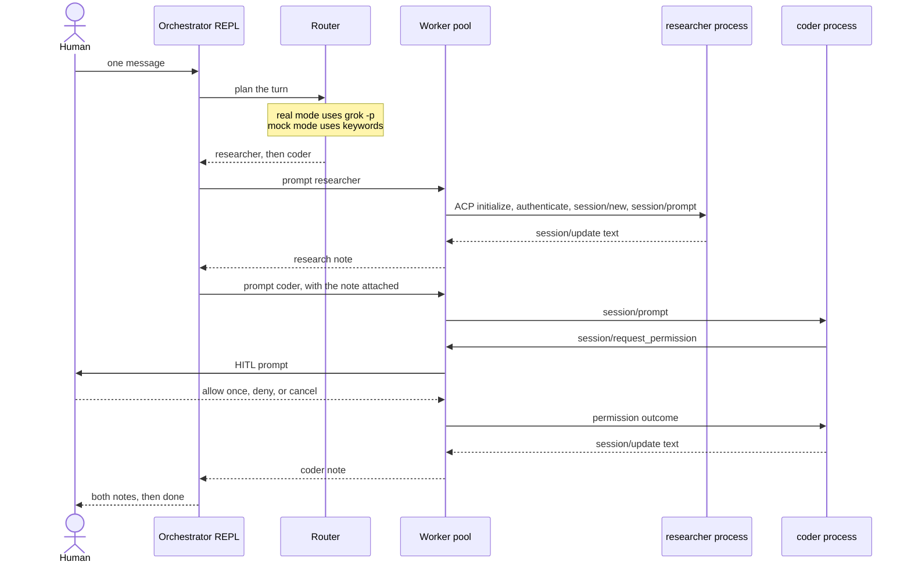

# grok-cli-orchestrator

A small desk that copies the *shape* of a Grok Bot: the human talks to one orchestrator, and that orchestrator routes work to specialist Grok CLI processes. It is a prototype of the pattern, not a Grok Bot clone and not an xAI product.

Workers are child processes. The orchestrator speaks [Agent Client Protocol](https://agentclientprotocol.com) (newline-delimited JSON-RPC) to each one. When a worker needs a human, the turn pauses and the orchestrator asks you.

Mock mode runs the same client against a local ACP stand-in, so the demo does not need `grok` or an API key.

## Architecture



```text
you  ->  src/index.ts          the only human interface
            |  plan
            v
         src/router.ts         grok -p  (or the keyword router)
            |
            v
         src/worker_pool.ts    one child per worker
            |  ACP JSON-RPC on stdin/stdout
            +--> grok agent stdio   researcher   (or scripts/mock-grok-agent.mjs)
            +--> grok agent stdio   coder
            |
            +--> src/hitl.ts        session/request_permission -> you
```

## How this maps to a Grok Bot

| Idea | In this repo |
| --- | --- |
| The human has one conversation | `npm start`. Workers have no terminal of their own. |
| One orchestrator decides who works | `src/orchestrator.ts` asks the router, then calls workers in order. Each later worker sees the earlier notes. |
| The orchestrator itself is a Grok CLI call | Real mode plans with one `grok -p` invocation per turn (`--output-format json`). Mock mode uses a keyword router so the desk still runs offline. |
| Specialists / decision stations | `orchestrator.yaml`. Each entry is its own process, rules, working directory, and permission mode. |
| Process IPC, not three terminals you open | `src/worker_pool.ts` spawns the children and `src/acp_client.ts` speaks ACP. |
| A person must approve a risky step | The worker emits `session/request_permission`. `src/hitl.ts` prints the tool and waits. The worker turn does not finish until you answer. |

## Layout

| Path | Role |
| --- | --- |
| `src/index.ts` | REPL, `--once`, and stdin |
| `src/orchestrator.ts` | Plan, delegate, print the turn |
| `src/router.ts` | `grok -p` planner and the keyword fallback |
| `src/acp_client.ts` | JSON-RPC over a child process |
| `src/worker_pool.ts` | Spawn, handshake, prompt, forward permissions |
| `src/hitl.ts` | Human approval |
| `src/config.ts` | YAML or JSON worker list |
| `orchestrator.yaml` | Researcher (always-approve) and coder (ask) |
| `agents/*.md` | Files passed to `--agent-profile` |
| `scripts/mock-grok-agent.mjs` | ACP stand-in used when `--mock` / `MOCK_GROK=1` |
| `scripts/demo-mock.sh` | Non-interactive mock scenario |

## Prerequisites

Node.js 20 or newer.

Real mode also needs the Grok Build CLI on `PATH` ([install docs](https://docs.x.ai/build/overview)):

```bash
curl -fsSL https://x.ai/cli/install.sh | bash
# or: npm install -g @xai-official/grok
```

Authenticate once, either in a browser or with an API key:

```bash
grok login
# headless: grok login --device-auth
# or: export XAI_API_KEY="xai-..."
```

Mock mode does not use either of those.

## Run

```bash
npm install
```

Mock, interactive:

```bash
npm start -- --mock
```

Mock, one turn (what CI and the demo script do):

```bash
npm run demo
# or
MOCK_GROK=1 npm start -- --hitl allow --once "Research how ACP permission requests work, then sketch a tiny shell health check."
```

On a TTY the default is `--hitl ask`. You get:

```text
hitl> [a]llow once  [d]eny  [c]ancel
hitl>
```

`a` allows once, `d` denies, `c` cancels. Enter with no letters denies. For scripts, pass `--hitl allow`, `--hitl deny`, or set `HITL_DECISION`.

Real mode (spawns `grok`):

```bash
npm start
```

`/workers` lists stations. `/quit` exits. A worker whose name is printed with `*` is the one that can stop and ask you.

If `grok` is not on `PATH`, real mode stops and tells you to install it or pass `--mock`. It does not silently fake a model.

## Demo transcript

This is the output of `npm run demo`. The researcher text and the file sketch come from the mock agent, not from a live model. The permission round-trip is real ACP: the coder child sends `session/request_permission`, and the orchestrator answers before the coder turn ends.

```text
grok-cli-orchestrator  mode=mock  router=deterministic  workers=researcher,coder*
workers marked * ask you before tools run.
you> Research how ACP permission requests work, then sketch a tiny shell health check. Writing the file needs approval.
orchestrator> plan (deterministic): researcher -> coder

researcher>
ACP permission flow (MOCK_GROK, not a live model):
The host sends session/prompt. If a tool needs a human, the agent emits session/request_permission with a toolCall and options (allow_once / reject_once). The host answers with outcome selected or cancelled. --always-approve and session _meta.yoloMode skip that ask; deny rules still apply.
Request excerpt: Research how ACP permission requests work, then sketch a tiny shell health check. Writing the file needs approval.
hitl> coder: Write scripts/healthcheck.sh
hitl> input: {"path":"scripts/healthcheck.sh","content":"#!/bin/sh\ntest -f package.json\n"}
hitl> options: Allow once (allow_once), Reject (reject_once)
hitl> decision: allow once (--hitl allow)

coder>
Approved write of scripts/healthcheck.sh.

#!/bin/sh
# Mock snippet. Real mode would be written by grok after you allow the tool.
test -f package.json

orchestrator> finished 2 steps.
```

Deny the same turn with `--hitl deny`. The coder reply then says the human denied the write, and the file is not described as approved.

## What real mode actually runs

Planner, once per user message, only when `router` is `auto` or `grok` and mock mode is off:

```bash
grok --no-auto-update -p "<plan prompt>" \
  --output-format json \
  --always-approve \
  --max-turns 1 \
  --rules "You are a router. Output one JSON object and nothing else. Do not call tools. Do not solve the user task."
```

The planner must reply with `{"steps":[{"worker":"<name>","task":"..."}]}` inside the JSON `text` field. If `router` is `auto` and that call fails, the keyword router is used and the failure is printed. If `router` is `grok`, the failure stops the turn.

Each worker:

```bash
grok --no-auto-update agent \
  --agent-profile <profileFile> \
  [--always-approve] \
  stdio
```

`--always-approve` is added only when that worker's `alwaysApprove` is true. The coder in the shipped config omits it, so a tool that Grok would normally ask about becomes `session/request_permission` here.

Handshake, in order:

1. `initialize` with `protocolVersion: 1`. File and terminal client capabilities are off, because this host does not serve those reverse calls.
2. `authenticate` when the agent advertises a method. `XAI_API_KEY` selects `xai.api_key` when that method is offered; otherwise `cached_token` (from `grok login`). The call includes `_meta.headless: true`. An empty method list means the agent is already authenticated, and the client skips this step.
3. `session/new` with absolute `cwd`, `mcpServers: []`, and `_meta`:
   - `rules` — the worker's role text
   - `agentProfile` — the `profile` string in the YAML, or a JSON object if `profile` itself is a JSON object
   - `yoloMode` — the same boolean as `alwaysApprove`
4. `session/prompt` with a text block. Assistant text is collected from `session/update` / `agent_message_chunk`. `stopReason` comes back on the prompt result.
5. While the prompt is in flight, `session/request_permission` is answered with `outcome.selected` (`allow_once` or `reject_once`) or `outcome.cancelled`.

The same session is reused for later turns to that worker. On a prompt timeout the client sends `session/cancel` and then reports the error.

`GROK_BIN` overrides `grokBin` in the config. `GROK_CLIENT_VERSION` is set to `grok-cli-orchestrator/0.1.0` on real worker processes.

## Config

`orchestrator.yaml` is the default. `orchestrator.json` works too if you pass `--config`. Paths are resolved from the config file's directory.

```yaml
grokBin: grok
router: auto # auto | grok | deterministic
workers:
  - name: researcher
    profile: researcher
    profileFile: agents/researcher.md
    cwd: .
    alwaysApprove: true
    rules: |
      Persona: researcher
      You are the researcher. Do not edit files.
```

`profile` is sent as `_meta.agentProfile`. Grok resolves that name before `--agent-profile`. The names `researcher` and `coder` are for this desk and for the mock. If a real `session/new` rejects an unknown profile, delete the `profile` key. The role still arrives through `rules`, and the markdown file still arrives through `--agent-profile`.

To add a station, add a worker whose `name` is lowercase. The keyword router already knows `reviewer` (`review`, `audit`) if you add one. The `grok -p` planner can use any name in the file.

## Tests

```bash
npm test
npm run typecheck
```

`npm test` covers the router, the spawn arguments, permission outcomes, and a full mock turn (allow, deny, and always-approve). It also runs the CLI once. `npm run demo` checks the same transcript and exits 0.

## Limits

- The mock coder always asks about `scripts/healthcheck.sh` on its first turn, then remembers the answer for that process. It does not decide which tool to call.
- In real mode a permission prompt appears only when Grok actually tries a tool that is still in ask mode. Always-approve workers will not ask.
- The planner does not keep a long-lived ACP session. Each turn is a new `grok -p`. A persistent planner process is the natural next step if the route should remember earlier turns without this app resending the worker list.
- There is no desktop UI, sandbox editor, or multi-user session. One terminal, one person.
